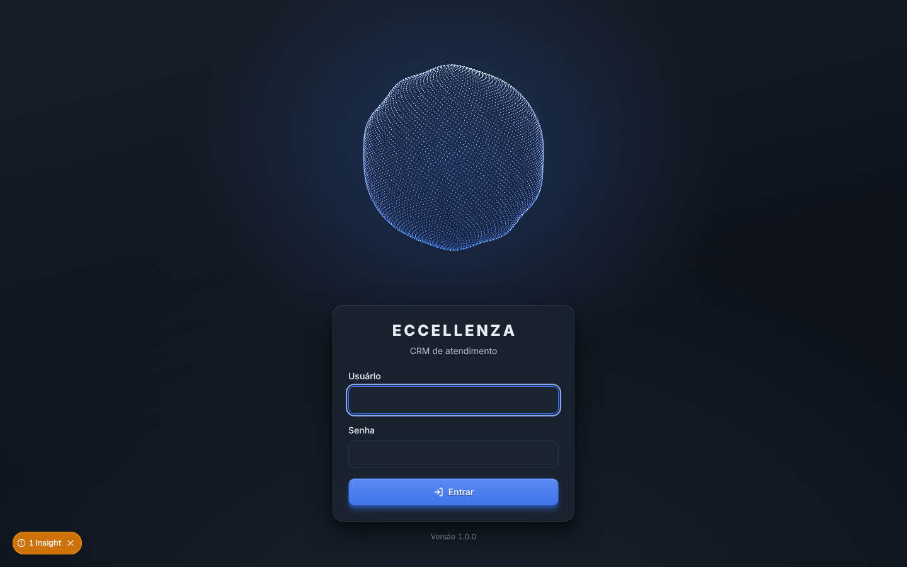

# Login antigo: a esfera de pontos (guardado em 23/11/2026)

Tela de login usada até a tarefa 46, quando entrou a cena "Da conversa ao card" (`tarefas/46-login-da-conversa-ao-card.md`).
Guardada a pedido do Mateus, para poder voltar se ele quiser.

| Arquivo aqui | Onde ficava |
|---|---|
| `page.tsx` | `src/app/login/page.tsx` |
| `esfera-3d.ts` | `src/componentes/login/esfera-3d.ts` (esfera de pontos em Three.js: física, colisão com o cartão, ondas no clique) |
| `esfera-shader.ts` | `src/componentes/login/esfera-shader.ts` |
| `login-esfera.css` | trecho do fim de `src/app/globals.css` (`.login-halo`, `.login-onda`, `.login-cartao`, `.login-nome-parado`). O `.login-fundo` continua no `globals.css`: as páginas públicas usam |
| `print-pc.png`, `print-iphone.png` | como a tela era, em 1440×900 e no iPhone (390×844) |

Os arquivos desta pasta não entram no build (`tsconfig.json` exclui `docs/legado`).
No GitHub também existe a marca (tag) **`login-esfera-v1`**, apontando para a versão do CRM que ainda tinha este login.

## Como voltar para este login
Peça ao Claude: "volta o login da esfera que está em docs/legado/login-esfera". Os passos são:
1. Copiar `page.tsx` para `src/app/login/page.tsx` e os dois `esfera-*.ts` para `src/componentes/login/`.
2. Colar o conteúdo de `login-esfera.css` no fim de `src/app/globals.css`, antes do bloco "Gaveta do lead aberta".
3. Instalar de volta o Three.js: `npm install three@0.160.0` e `npm install -D @types/three@0.160.0`.
4. Apagar a cena nova (`src/componentes/login/cena/` e `src/app/login/login.css`), se não for mais usada.
5. Atualizar `docs/mapa-do-codigo.md` (linha "Tela de login") e rodar `npm test` e `npm run tipos`.
